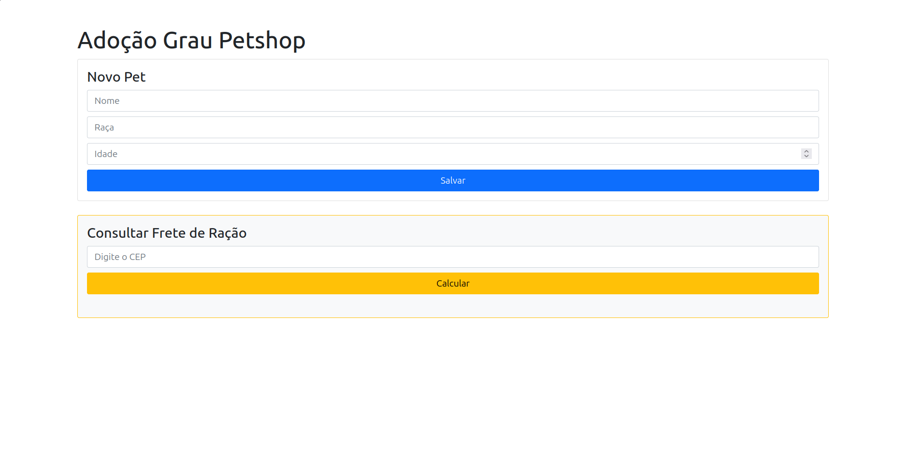

# 🚀 Desenvolvimento Back-End: CRUD & Consumo de APIs Externas com Node.js & TypeScript

Repositório dedicado à **evolução do meu aprendizado em desenvolvimento Back-End** como parte do curso de **Desenvolvimento Full Stack**.

Nesta segunda etapa, evoluí a aplicação para construir uma API REST completa com operações de **CRUD (Create, Read, Update, Delete)** para gerenciamento de dados na memória, além de integrar o servidor a uma **API externa (ViaCEP)** utilizando requisições assíncronas com `fetch` e regras de negócio condicionais.

---

## 🛠️ Tecnologias e Ferramentas Utilizadas

- **Node.js**: Ambiente de execução JavaScript no servidor.
- **TypeScript**: Superset de JavaScript que adiciona tipagem estática e segurança ao código.
- **Express.js**: Framework para criação de APIs e gerenciamento de rotas HTTP.
- **Fetch API / Async & Await**: Utilizado para consumo de serviços web externos.
- **tsx**: Executor TypeScript de alta performance para o ambiente de desenvolvimento.

## 🖥️ Preview da aplicação



---

## 🧠 Conceitos Aprendidos e Aplicados

Durante esta aula prática, aprofundei os seguintes conceitos:

### 1. Operações CRUD e Verbos HTTP
- **`GET`**: Leitura de dados cadastrados.
- **`POST`**: Criação de novos registros no sistema com envio de dados no corpo da requisição (`req.body`).
- **`PUT`**: Atualização pontual de registros existentes utilizando parâmetros da URL.
- **`DELETE`**: Remoção de itens do banco de dados simulado na memória.

### 2. Validações e Status Codes HTTP
- `200 OK`: Operação realizada com sucesso.
- `201 Created`: Novo recurso criado com sucesso.
- `404 Not Found`: Registro ou endereço de CEP não localizado.

### 3. Integração com APIs Externas (Assincronismo)
- Consumo da API pública do **ViaCEP** utilizando `async/await` e `fetch`.
- Aplicação de **regras de negócio**: cálculo condicional de frete com base na localidade retornada pelo CEP.

---

## 📌 Rotas Criadas na API

### 🐶 Gerenciamento de Pets (CRUD)

| Método | Rota | Descrição |
| :--- | :--- | :--- |
| `GET` | `/pets` | Retorna a lista de pets cadastrados. |
| `POST` | `/pets` | Cadastra um novo pet (requer campo `nome` no corpo JSON). |
| `PUT` | `/pets/:id` | Atualiza um ou mais campos (`nome`, `raca` e/ou `idade`) do pet. |
| `DELETE`| `/pets/:id` | Remove o pet do sistema correspondente ao ID. |

### 📍 Cálculo de Frete (Integração ViaCEP)

| Método | Rota | Descrição |
| :--- | :--- | :--- |
| `GET` | `/frete/:cep` | Calcula o frete com base na cidade do CEP informado. |

---

## ⚙️ Como Executar o Projeto Localmente

1. **Inicie o backend** em um terminal:
   ```bash
   cd backend
   npm install
   npx tsx server.ts
   ```

2. **Inicie o frontend** em outro terminal:
   ```bash
   cd frontend
   npm install
   npm run dev
   ```

3. **Exemplos de acesso à API:**
   - Listar Pets: `http://localhost:3000/pets`
   - Calcular Frete: `http://localhost:3000/frete/54310000`

Os dados dos pets ficam armazenados em memória e são apagados quando o servidor é reiniciado. A rota de cadastro ainda não valida os campos recebidos.

---

✨ Desenvolvido por **Ricardo** durante as aulas de Desenvolvimento Full Stack.